          
          

---

## 🕸️ About Me (shaspie)

Welcome! I am Sharif Bin Aziz Shadman, a curious robotics and technology geek.

I like to make, code, learn something new everyday, take pictures and be experimental. I am a perpetual student who am always learning and trying to get better with every single project that I execute.

I am not an expert, I just really like to learn, tinker around and experiment with new things. Right now I am learning Supabase — databases, auth, and backends — and also C++ and Python, alongside the tools I already use.

> ### 🤖 **Robotics - I have the most fun.**
> **Building robots with servos, motors & Arduino** is my favorite way to bring code to life.

---

## 🛠️ I am still learning.

---

---

## 🌱 What I'm Into

<table align="center">
<tr>
<td align="center" width="200">🌐 <b>Building Websites</b> Clean, responsive sites</td>
<td align="center" width="200">📸 <b>Photography</b> Telling stories through frames</td>
<td align="center" width="200">🔌 <b>IoT</b> Connecting devices to the web</td>
<td align="center" width="200">🤖 <b>ROBOTICS</b> Servos, motors & Arduino</b> My favorite thing to build!</td>
</tr>
</table>

📚 <b>I am learning something new with every project — currently C++, and Python.</b>

---

## 🤖 Robotics Spotlight

<b>Robotics is the part of tech I enjoy most — turning code into things that move, sense and react.</b>

---

<i>I have no special talents. I am only passionately curious. - Albert Einstein ✨</i>

